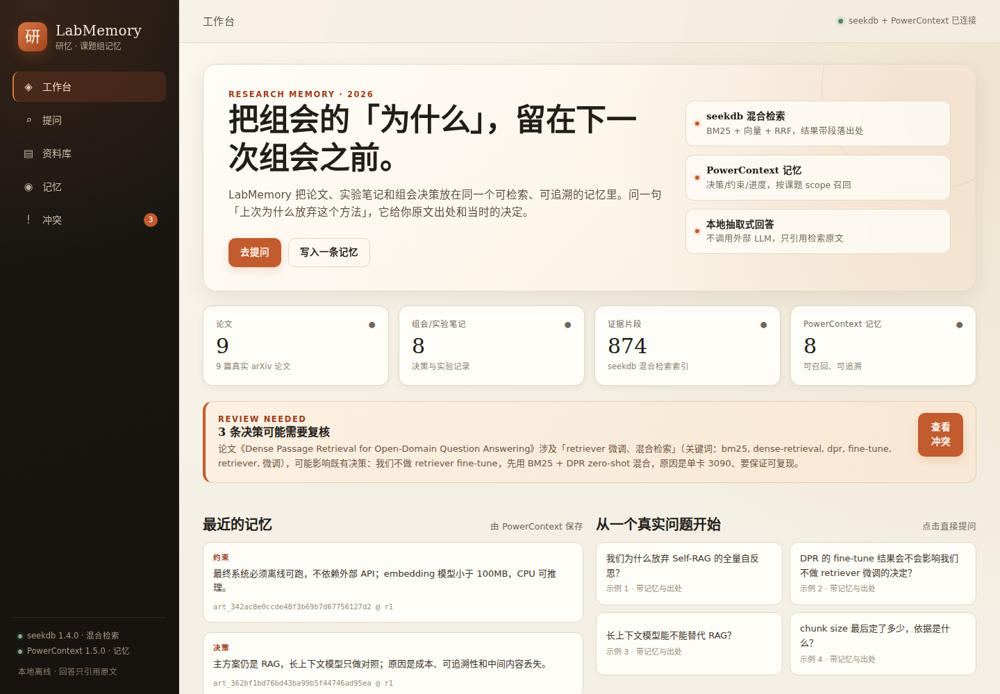
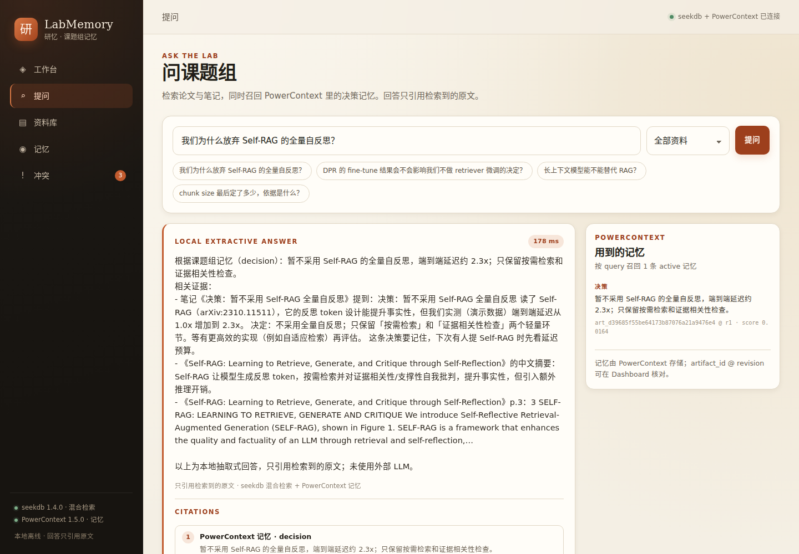

# LabMemory · 研忆

**把组会的「为什么」，留在下一次组会之前。**

LabMemory 是一个面向科研小组的「可追溯记忆」工具：把论文、实验笔记和组会决策放进同一个可检索、可追溯的系统。问一句「上次为什么放弃这个方法」，它同时给你 **原文出处** 和 **当时的决定**。

- 赛道：OceanBase 大赛 · Qoder 赛题（学习科研 / 工作提效）
- 核心技术：**seekdb**（BM25 + 向量 + 标量过滤，RRF 混合检索）+ **PowerContext 1.5.0**（显式决策记忆与召回）
- 开发工具：**Qoder**（CLI / 桌面端）；发布：**Qoder Sites**
- 演示站点：<待 Qoder Sites 发布后填入>
- 代码目录：<code>powercontext-2026/qoder/labmemory</code>（分支 <code>2026-competition-ecosystem</code>）

## 演示

真实运行截图（本地 127.0.0.1:8000）：

演示问题：

1. 我们为什么放弃 Self-RAG 的全量自反思？
2. DPR 的 fine-tune 结果会不会影响我们不做 retriever 微调的决定？
3. 长上下文模型能不能替代 RAG？
4. chunk size 最后定了多少，依据是什么？

## 解决的问题

科研组会最贵的工作不是读论文，而是重新找回上下文：

- **找不到**：几十篇 PDF，只记得「有一篇讲过」，却翻不到那一页。
- **记不住**：决策的理由没有落盘，下次开会重新吵一遍。
- **对不上**：新论文与旧决策相关，却没人提醒需要复核。

LabMemory 把「证据」和「决定」接起来：seekdb 负责从论文/笔记中找证据，PowerContext 负责记住课题组已经做过的决定，并在新论文出现时提示复核。

## 核心功能

- **论文/笔记入库**：9 篇真实 arXiv 论文 PDF + 8 条组会/实验笔记；按页切 chunk，每篇生成中文摘要 chunk。
- **混合检索**：seekdb <code>MATCH ... AGAINST</code>（BM25）+ <code>l2_distance(embedding, ...)</code>（向量）+ 标量过滤；RRF(k=60) 融合；结果带论文/笔记、章节、页码、BM25/距离/RRF 分数。
- **证据型回答**：本地抽取式摘要，只引用检索到的原文；没有证据就明确说找不到；不调用外部 LLM。
- **PowerContext 记忆**：8 条显式记忆（决策/约束/进度/待办）；提问时召回；回答和记忆页显示 <code>artifact_id @ revision</code>。
- **冲突提醒**：规则版扫描；新论文的方法/关键词与既有决策重叠时提示「可能影响决策」，可生成复核任务。
- **五个页面**：工作台、提问、资料库、记忆、冲突；响应式，无外部 CDN。

## 架构

~~~mermaid
flowchart LR
  U[研究者] --> FE[Web 前端 HTML/CSS/JS]
  FE --> API[FastAPI /api/ask /api/search /api/memories]
  API --> S[(seekdb 1.4 papers/notes/chunks)]
  API --> PC[(PowerContext 1.5 decision/constraint/progress)]
  S --> R[BM25 + 向量 + RRF]
  PC --> M[记忆召回]
  R --> A[带出处的回答]
  M --> A
  A --> FE
~~~

技术分工：

| 技术 | 在项目中的角色 | 可核对证据 |
|---|---|---|
| seekdb | 论文/笔记 chunk 的存储与混合检索；874 个 chunk；全文索引 + 384 维向量索引 + 标量过滤 | 检索轨迹、SQL 日志、<code>queries.trace_json</code>、截图 |
| PowerContext | 决策/约束/进度/待办的显式记忆与召回；scope 隔离；artifact revision | <code>/v1/memory/entries/list</code>、回答中的 <code>artifact_id @ r1</code>、记忆页 |
| Qoder | 需求拆解、编码/调试、测试与发布；会话记录 | <code>docs/qoder-log.md</code> + 截图 + commit |
| Qoder Sites | 发布项目展示站，公网可访问 | 站点 URL（待填） |

## 技术栈

- Python 3.12 + FastAPI + Uvicorn + PyMySQL + PyMuPDF + fastembed
- seekdb 1.4.0（MySQL 协议兼容；VECTOR + FULLTEXT + 标量索引）
- PowerContext 1.5.0（本地 Server，Basic memory，无需外部模型 API）
- 前端：原生 HTML/CSS/JS，无 Node 构建
- Embedding：<code>sentence-transformers/paraphrase-multilingual-MiniLM-L12-v2</code>（384 维，多语言，ONNX/CPU）

## 仓库结构

~~~text
qoder/labmemory/
  README.md
  SPEC.md
  .env.example
  backend/
    app/            # FastAPI、seekdb、检索、PowerContext、冲突
    seed/           # papers.json + ingest.py
  frontend/         # index.html / styles.css / app.js
  data/
    papers/*.pdf    # 9 篇真实 arXiv 论文
    notes/*.md      # 8 条演示场景笔记
  scripts/          # 启动、验证、截图脚本
  docs/             # Qoder 记录、验证样例、架构说明、截图
  site/             # Qoder Sites 展示站（静态）
~~~

## 快速开始（WSL2 Ubuntu / Linux）

### 0. 前置

- WSL2 Ubuntu（或 Linux），Python 3.12，<code>uv</code>，Docker（可选）
- 至少 2GB 内存；首次运行需下载约 220MB embedding 模型
- 不需要任何外部 LLM / API Key

### 1. 启动 seekdb

方式 A：Docker（推荐给评审）

~~~bash
docker run -d --name labmemory-seekdb -p 2881:2881 oceanbase/seekdb
# 等 10-20 秒，确认可连接
mysql -h127.0.0.1 -P2881 -uroot -e "SELECT 1"
~~~

方式 B：使用已有 seekdb 二进制

~~~bash
mkdir -p ~/labmemory-seekdb
~/sdb-src/build_release/src/observer/seekdb \
  --base-dir ~/labmemory-seekdb --port 2881 --nodaemon
~~~

默认 root 空密码。若设置了密码，在 <code>.env</code> 里填 <code>SEEKDB_PASSWORD</code>。

### 2. 启动 PowerContext 1.5

~~~bash
uv tool install --python 3.12 "powercontext[cli,server]==1.5.0"

mkdir -p ~/powercontext-manual
cat > ~/powercontext-manual/manual.env <<'EOF'
POWERCONTEXT_SERVER_HTTP_HOST=127.0.0.1
POWERCONTEXT_SERVER_HTTP_PORT=18080
POWERCONTEXT_SERVER_DASHBOARD_ENABLED=true
POWERCONTEXT_SERVER_ACCESS_MODE=disabled
EOF

powercontext config validate --env-file ~/powercontext-manual/manual.env
powercontext server run --env-file ~/powercontext-manual/manual.env
~~~

看到 <code>Uvicorn running on http://127.0.0.1:18080</code> 即可；Basic memory 不需要模型 API。

### 3. 安装应用依赖

~~~bash
cd /path/to/qoder/labmemory
uv venv ~/venvs/labmemory --python 3.12
uv pip install --python ~/venvs/labmemory/bin/python \
  fastapi uvicorn pymysql pymupdf fastembed numpy httpx python-dotenv pydantic
cp .env.example .env
~~~

如果 HuggingFace 访问慢，先设置：

~~~bash
export HF_ENDPOINT=https://hf-mirror.com
~~~

### 4. 导入数据 + 写入记忆

~~~bash
~/venvs/labmemory/bin/python -m backend.seed.ingest --reset
~~~

预期输出（首次会下载模型，约 1-3 分钟）：

~~~json
{
  "papers": 9,
  "chunks": 874,
  "memories_created": 8,
  "conflicts": {"created": 3, "scanned": 54, "candidates": 10},
  "counts": {"papers": 9, "notes": 8, "chunks": 874, "queries": 0, "conflicts": 3}
}
~~~

脚本会自动创建 PowerContext scope，并把 <code>PC_SCOPE_ID</code> 写回 <code>.env</code>。

### 5. 启动应用

~~~bash
~/venvs/labmemory/bin/uvicorn backend.app.main:app \
  --host 0.0.0.0 --port 8000
~~~

打开 http://127.0.0.1:8000

也可以使用：

~~~bash
bash scripts/start_all.sh
~~~

## 验证样例

完整版见 <code>docs/VERIFICATION.md</code>。最小验证：

~~~bash
curl -s http://127.0.0.1:8000/api/health
# {"seekdb":"ok","powercontext":"ok","scope_id":"scp_...","counts":{...}}

curl -s -X POST http://127.0.0.1:8000/api/ask \
  -H 'Content-Type: application/json' \
  -d '{"query":"我们为什么放弃 Self-RAG 的全量自反思？"}'
~~~

预期：

- 回答包含「根据课题组记忆（decision）：暂不采用 Self-RAG 的全量自反思…」
- 证据包含 Self-RAG 论文 <code>p.3</code> 与中文摘要
- <code>memories[0].artifact_id</code> 形如 <code>art_...</code>，<code>revision = 1</code>
- <code>trace.bm25_count &gt; 0</code>、<code>trace.vector_count &gt; 0</code>、<code>trace.rrf_k = 60</code>

直接核对 seekdb：

~~~bash
mysql -h127.0.0.1 -P2881 -uroot labmemory -e \
  "SELECT COUNT(*) AS chunks FROM chunks;
   SELECT source_title, section, page,
          MATCH(search_text, keywords) AGAINST ('Self-RAG') AS bm25
   FROM chunks
   WHERE MATCH(search_text, keywords) AGAINST ('Self-RAG') > 0
   ORDER BY bm25 DESC LIMIT 5;"
~~~

直接核对 PowerContext：

~~~bash
curl -s -X POST http://127.0.0.1:18080/v1/memory/entries/list \
  -H 'Content-Type: application/json' \
  -d '{"scope_id":"<PC_SCOPE_ID>","limit":20}'
~~~

## 数据来源

- 9 篇论文均为真实 arXiv 论文，PDF 位于 <code>data/papers/</code>，标题/链接可在网站「数据来源」逐条核对。
- 8 条组会/实验笔记为**演示场景数据**，基于论文内容编写；实验数值（如延迟 2.3x、recall 0.71）为演示数据，不是真实实验结论。
- 未复用外部代码；论文引用仅用于检索演示，遵循 arXiv 各自许可。

## Qoder 开发记录

- 账号 UID：<待登录后填写>
- 记录文件：<code>docs/qoder-log.md</code>
- 说明：项目脚手架、论文下载、演示笔记和规格文档由人工准备；核心代码/前端/测试由 Qoder 完成或 Qoder 参与完成，逐条留痕；不伪造会话。

## 提交材料

- 项目网站：<待 Qoder Sites 发布>
- 代码仓库：<待 push / 开放评审权限>
- 运行说明：本 README
- 验证样例：<code>docs/VERIFICATION.md</code>
- Qoder 开发记录：<code>docs/qoder-log.md</code>
- 一页项目介绍：<code>docs/one-pager.md</code>
- 架构说明：<code>docs/ARCHITECTURE.md</code>

## 已知限制

- 回答是本地抽取式，不做多跳推理；没有证据时会明确拒答。
- PDF 解析以正文段落为主，表格/公式不做高精度还原。
- 冲突提醒是规则版，只提示「可能影响」，不自动改决策。
- 首次运行需下载 embedding 模型；离线环境可预先把模型缓存到 <code>~/.cache</code>。

## License

仅用于 OceanBase 大赛 Qoder 赛题提交与评审。第三方论文版权归原作者/出版方所有。
